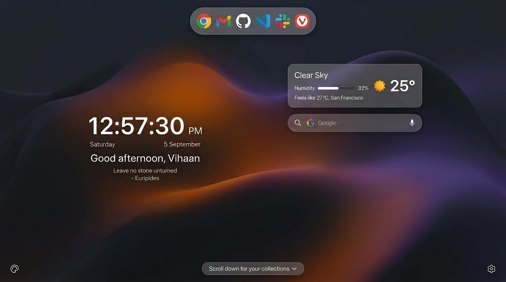
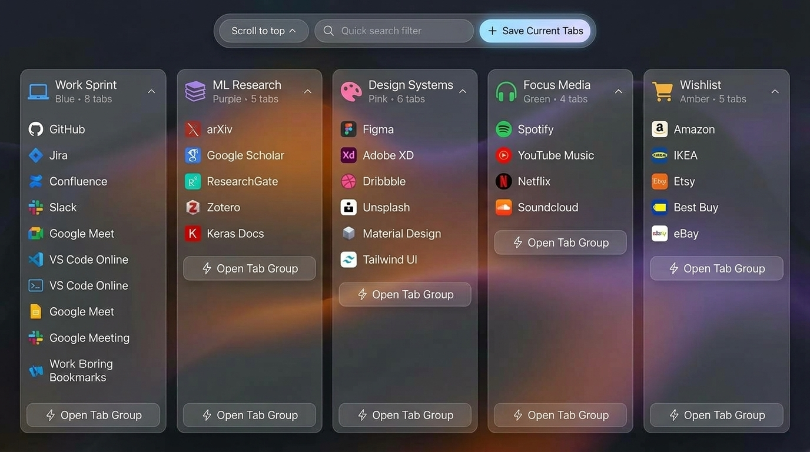
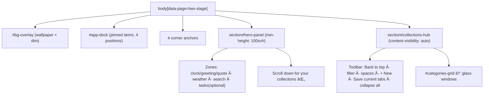
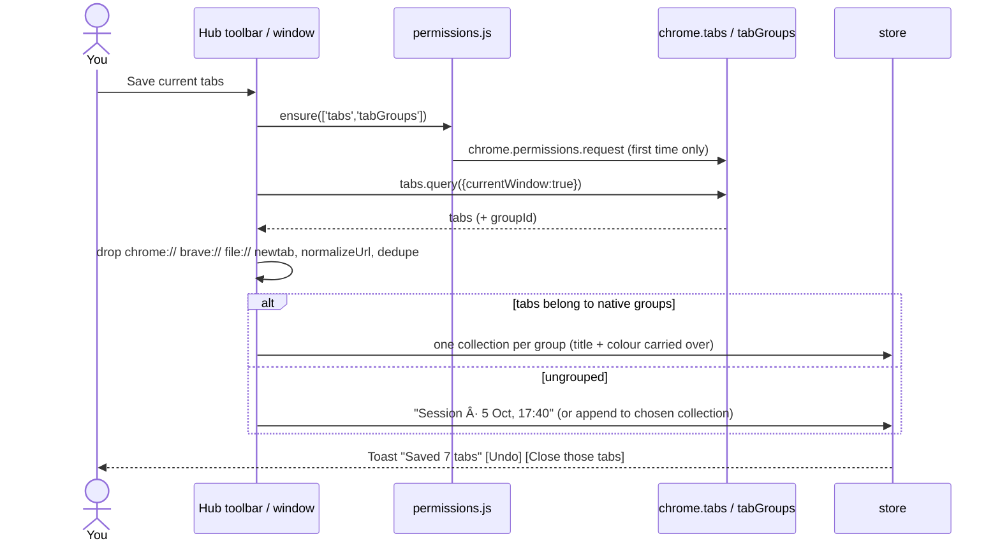
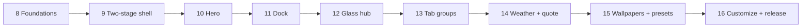

# UI Overhaul Roadmap — "Glass Dashboard" (v0.3.0)

Phases 8–16 extend `docs/ROADMAP.md` (Phases 0–7, shipped as v0.2.0). The process rules from that roadmap still apply: one phase at a time, one commit per feature, tests ship with the feature, a gate report after each phase, and verification in a running Chrome (Brave manually by you).

> [!NOTE]
> This replaces the earlier exploratory doc `dynamic_dashboard_glass_plan.md`. Concepts you rejected — the search-bar pull-down launcher with tab groups, duplicate search bars, cluttered single-screen layouts — are **out of scope**.

---

## 1. Goal

Turn the dashboard into a two-stage page modelled on Microsoft Edge's new tab:

| Screen 1 — Main panel (what you see on open) | Screen 2 — Collections hub (after scrolling down) |
|---|---|
|  |  |
| Wallpaper, dock (nav bar), clock + greeting, weather, search, a "Scroll down for your collections" prompt. **No collections visible.** | Columns of collapsible glass windows (collections = tab groups), each with a colour tag, plus **Save current tabs**, **Open as tab group**, a filter box and Back to top. |

Everything that exists today keeps working (see §4).

---

## 2. Decisions (approved 5 Oct 2026)

| # | Topic | Decision |
|---|---|---|
| D1 | Design rules | **Approved.** `SKILL.md` and `DESIGN_SYSTEM.md` are rewritten to "Glass v2" in Phase 8.0 |
| D2 | Permissions | `tabs` and `tabGroups` go in `optional_permissions` and are requested on first use of Save / Open as group |
| D3 | Network | Weather via Open-Meteo, **off by default**, opt-in; CSP `connect-src` lists only the two Open-Meteo hosts; 30-minute cache |
| Q1 | Landing | **Always open on the main panel** |
| Q2 | Classic layout | **Kept for now**, marked deprecated; scheduled for removal after v0.3.0 (tracked in §6 "Later") |
| Q3 | Moving widgets | **Free drag anywhere** on the main panel, plus resize. Positions stored as viewport percentages so they survive window resizing; snap guides and keyboard nudging keep it accessible |
| Q4 | Tabbed stack view | Optional **second hub view** (toggle in the hub toolbar); columns stay the default |
| Q5 | Saved tab sessions | Normal collections with a "Saved from tabs" badge (one system) |
| Q6 | Weather location | Manually chosen city; "Use my location" is offered as an optional extra button |

## 3. Open Questions

None. All resolved above.

---

## 4. Preservation Map (existing feature → new home)

| Existing feature (phase) | Where it lives after the overhaul | Change needed |
|---|---|---|
| Collections, bookmarks, CRUD, undo (core) | Hub glass windows | Styling only; same `Category` data |
| Drag and drop, drop/paste to add (2.3) | Hub; dropping a link on the hero opens the add dialog | None |
| Edit mode `e`, inline rename (2.2) | Both screens; also turns on widget zone editing (Phase 16) | Extend |
| Unified search, calculator, shortcuts (2.1) | Hero search pill; results dropdown overlays the hero | CSS only |
| Duplicate warning (2.4) | Unchanged; also runs on Save current tabs | Reuse |
| Pinned strip, Open all (2.5) | **Becomes the dock** (same `space.pinned` array) | Re-render |
| `g` jump, `?` help (2.6) | `g` scrolls to the hub first, then shows badges | Small |
| Spaces, `[` `]` (3.1) | Hub toolbar and top-left corner button; also switches the dock | Move DOM |
| Bulk ops, sort, collapse all (3.2, 3.3) | Hub toolbar | Move DOM |
| Custom icons, imports, first run (3.4–3.6) | Unchanged; tour steps re-targeted | Update tour |
| Card styles, layout, display modes (4.1–4.3) | Adds `glass` style (default when a wallpaper is set) | Extend |
| Palettes, accent, presets, schedule (4.4–4.6) | Unchanged; adds "Glass" presets | Extend |
| Wallpaper library, readability, rotation (5.x) | Unchanged; drives glass opacity; quick tuner in the bottom-left corner | Extend |
| Clock styles, fonts, name, countdown (6.1–6.3) | Hero; adds a `hero` clock size | Extend |
| Focus mode `f`, auto-hide (6.4, 6.5) | Focus mode locks the page to the hero; auto-hide fades the dock and corners | Small |
| Accessibility, i18n (7.1, 7.2) | All new strings go in `_locales`; reduced motion/transparency respected | Required |
| Notes, To-do widgets (7.3, 7.4) | Optional slot in the hero's right column (as in the reference's "YOUR TASKS") or in the hub | Move |
| Snapshots, import/export (1.2, data-io) | Unchanged; a snapshot is taken before the v3 migration | Extend validators |

**Rule:** no existing test is deleted. If a test asserted DOM placement that moves, the gate report says so and explains the change.

---

## 5. Architecture

### 5.1 Page structure



The existing IDs (`#clock-display`, `#search-form`, `#categories-grid`, `#pinned-strip` → `#app-dock`, `#space-switcher`, `#widgets-container`) are **kept**, so the current render functions and tests continue to find their elements.

```html
<body data-page="two-stage">
  <div id="bg-overlay" aria-hidden="true"></div>
  <nav id="app-dock" class="app-dock" data-position="top" aria-label="Quick launch" hidden></nav>
  <div class="corner corner-tl">…spaces / jump to collections…</div>
  <div class="corner corner-tr">…edit mode · hero layout…</div>
  <div class="corner corner-bl">…wallpaper tuner…</div>
  <div class="corner corner-br">…settings…</div>

  <section id="hero-panel" class="hero" data-hero-layout="studio" aria-label="Home">
    <div class="hero-zone" data-zone="left">  clock · date · greeting · quote </div>
    <div class="hero-zone" data-zone="right"> weather · search · (tasks) </div>
    <button id="scroll-to-hub" class="scroll-prompt">Scroll down for your collections</button>
  </section>

  <main id="collections-hub" class="hub" aria-label="Collections">
    <div class="hub-toolbar">…</div>
    <div id="categories-grid" class="categories-grid"></div>
  </main>
</body>
```

### 5.2 Schema v3 (one migration, snapshot first)

`repairSettings` already merges defaults, but the new **category** fields and the import validator need a version step. All new fields land in a single v2 → v3 migration:

```jsonc
"settings": {
  "page": "two-stage",                 // two-stage | classic   (classic = today's single page)
  "landing": "hero",                   // hero | remember
  "hero": {
    "layout": "studio",                // studio (asymmetric) | centered
    "zones": { "clock": "left", "weather": "right", "search": "right", "quote": "left", "tasks": "off" }, // default slots for the studio/centered presets
    "widgets": {                       // set by free drag (Q3); null = use the layout preset slot
      "clock":   { "x": null, "y": null, "w": null, "hidden": false },   // x/y = % of viewport (0–100) of the widget's centre; w = width in px, clamped 160–900
      "weather": { "x": null, "y": null, "w": null, "hidden": false },
      "search":  { "x": null, "y": null, "w": null, "hidden": false },
      "quote":   { "x": null, "y": null, "w": null, "hidden": false },
      "tasks":   { "x": null, "y": null, "w": null, "hidden": true }
    }
  },
  "dock": { "position": "top", "autoHide": false, "maxItems": 12 },   // top|left|bottom|right|off
  "glass": { "blur": 16, "opacity": 0.62 },                           // clamped 0–20px, 0.45–0.9
  "weather": { "enabled": false, "city": "", "lat": null, "lon": null, "unit": "c" },
  "quote":   { "enabled": true },
  "tabs":    { "closeAfterSave": false, "openAsGroup": true }
},
"categories": [{
  // existing fields unchanged …
  "color": null,                       // grey|blue|red|yellow|green|pink|purple|cyan|orange (Chrome group colours)
  "source": null,                      // null | "tabs"
  "savedAt": null                      // ISO date when created from tabs
}]
```

Every enum is clamped to its default, and the lat/lon range is validated. `migrate()` remains v0 → v1 → v2 → v3, with each step repairing data and never discarding it.

### 5.3 Glass tokens (in `tokens.css`)

```css
:root {
  --glass-bg: rgba(255,255,255,var(--glass-opacity,.62));
  --glass-border: rgba(255,255,255,.35);
  --glass-blur: blur(var(--glass-blur-px,16px)) saturate(150%);
  --glass-radius: 16px;
  --hero-clock-size: clamp(56px, 7vw, 96px);
}
:root[data-theme="dark"] { --glass-bg: rgba(18,21,26,var(--glass-opacity,.62)); --glass-border: rgba(255,255,255,.10); }
/* Glass only when there is something behind it */
:root:not([data-bg="image"]):not([data-bg="gradient"]) { --glass-blur: none; --glass-bg: var(--bg-surface); }
@media (prefers-reduced-transparency: reduce) { :root { --glass-blur: none; --glass-bg: var(--bg-surface); } }
```

Collapse animation, with no height measurement in JS:

```css
.glass-window-body { display:grid; grid-template-rows:1fr; transition:grid-template-rows 200ms ease-out; }
.category-card.collapsed .glass-window-body { grid-template-rows:0fr; }
.glass-window-body > .inner { overflow:hidden; }
@media (prefers-reduced-motion: reduce) { .glass-window-body { transition:none; } }
```

### 5.4 Save current tabs / Open as tab group



The new pure module `features/tab-groups.js` exports testable functions: `filterSavableTabs`, `tabsToCollections(tabs, groups)`, `chromeColorFor(category)`, `openCollectionAsGroup(category)`. The `chrome.*` calls sit behind a thin adapter so Node tests can mock them.

### 5.5 Weather (opt-in)

- `features/weather.js`: `fetchWeather(lat, lon)` → `api.open-meteo.com/v1/forecast?current=temperature_2m,relative_humidity_2m,apparent_temperature,weather_code`. City search uses `geocoding-api.open-meteo.com`, called only from settings.
- Cache `{ data, fetchedAt }` in `chrome.storage.local`. Fetch only when the cache is more than 30 minutes old, and **after** first paint. Offline or error → show the last cached value marked "updated 2 h ago", or hide the card.
- `weather_code` → label and icon via a local table (inline SVG, no icon fonts).
- CSP: `connect-src 'self' https://api.open-meteo.com https://geocoding-api.open-meteo.com`. Update the S1 test to allow only these hosts.

---

## 6. Phases



While work is in progress, the new shell sits behind `settings.page`. The default stays `classic` until Phase 16 switches it to `two-stage`, so a half-finished state is never what you see on a new tab.

### Phase 8 — Foundations
- **8.0** Rewrite `SKILL.md` and `DESIGN_SYSTEM.md` into Glass v2 (Decision 1). Update `PRODUCT_SPEC.md` non-goals for weather (opt-in) and tabs (optional permission). Save this roadmap as `docs/ROADMAP_V2.md`.
- **8.1** Schema v3 plus migration and validators (§5.2), with a snapshot before migrating.
- **8.2** Glass tokens, the `data-bg` root attribute (set by `applyBackground`), and a `glass` card style.
- **8.3** `features/permissions.js`: an `ensurePermissions()` wrapper, plus `optional_permissions: ["bookmarks","tabs","tabGroups"]`.
- Tests: `v3_migration.test.js`, `glass_tokens.test.js`, `permissions.test.js`. All existing tests stay green.

### Phase 9 — Two-stage page shell
- **9.1** Restructure `newtab.html` into `#hero-panel` and `#collections-hub`, keeping all existing IDs. `body[data-page]` switches between two-stage and classic.
- **9.2** Scroll behaviour: the hero is `min-height:100svh`; `scroll-snap-type: y proximity`; the scroll prompt and Back to top use `scrollIntoView` (instant under reduced motion). `PageDown` and `↓` on the hero go to the hub. The prompt hides once you scroll.
- **9.3** Landing: always open at the top of the main panel (`history.scrollRestoration = 'manual'` plus `scrollTo(0,0)` on load).
- **9.4** Integrations: `g` scrolls to the hub; focus mode `f` hides the hub and locks scrolling; the tour re-targets its steps; the first-run dialog still appears.
- **9.5** Performance: `content-visibility:auto; contain-intrinsic-size` on the hub so it costs nothing until scrolled to.
- Tests: `page_shell.test.js` (attribute switching, preserved IDs, focus-mode lock, `g` scroll call).

### Phase 10 — Hero composition
- **10.1** `studio` (clock left, cards right) and `centered` layouts via `data-hero-layout`; the toggle lives in the top-right corner and in settings.
- **10.2** Hero clock size, using the existing seconds/12h/date/second timezone options; greeting with name; offline daily quote (`assets/quotes.json`, about 120 public-domain quotes, chosen by day of year).
- **10.3** Restyle the search bar as a pill (same form, combobox and calculator) with an engine icon button. Its dropdown overlays the hero and is never clipped.
- **10.4** Four corner anchors: top-left spaces/jump, top-right edit + layout, bottom-left wallpaper tuner, bottom-right settings. The existing `.top-nav` buttons move here.
- **10.5** Optional tasks slot: the To-do widget can render in the hero's right column.
- Tests: `hero_layout.test.js`, `quote.test.js` (deterministic day → quote).

### Phase 11 — Dock
- **11.1** Render `space.pinned` as `#app-dock` (circular favicons, tooltips, `aria-label`s). The cap rises from 8 to 12 (setting).
- **11.2** Positions top / left / bottom / right / off; layout adjustments make sure the dock never covers the hero zones.
- **11.3** Auto-hide: reveal on edge hover or on keyboard focus (reusing the 6.5 pattern).
- **11.4** Pin by dragging a bookmark onto the dock; reorder by dragging or with ←/→ plus Alt; the `⋯` menu keeps "Pin to dock".
- Tests: `dock.test.js` (positions, cap, reorder, removing a deleted bookmark from the dock).

### Phase 12 — Glass collections hub
- **12.1** Collection cards become glass windows: header (icon, name, count, colour dot, `+`, `⋯`, collapse chevron) and body using the grid-rows collapse.
- **12.2** Responsive columns: 5 at ≥1600px, 4 at 1440, 3 at 1280, 2 at 1024, 1 at 768. These respect the existing 4.2 column, width and gap settings. Long collections scroll inside the card past a maximum height.
- **12.3** Colour tags: pick a Chrome group colour per collection in the edit dialog; it shows as a dot and a header tint.
- **12.4** Hub toolbar: Back to top, filter box (reuses `rankBookmarks`), space switcher, + New collection, Save current tabs (wired in Phase 13), Collapse/Expand all, bulk-ops bar.
- **12.5** "Tabbed stack" view (Q4): a toolbar toggle `Columns | Tabs`. Tabs view shows every collection as a pill tab along the top of one glass window, with only the selected collection's links inside; the selected tab is remembered per space. Stored as `settings.hub.view: "columns" | "tabs"`.
- Tests: extend `b3_collapse`; add `hub_columns.test.js` and `category_color.test.js`. List, grid and icon display modes still render.

### Phase 13 — Tab groups integration
- **13.1** Save current tabs (§5.4): grouped tabs → one collection per native group; ungrouped → a new "Session" collection or the chosen collection; the duplicate check runs; the toast offers Undo and Close those tabs.
- **13.2** Per-window "Save tabs here" action in the `⋯` menu.
- **13.3** Open as tab group: open all links, then `chrome.tabs.group` and `tabGroups.update({title, color})`. Ask for confirmation above 10 links. Fall back to plain Open all if the permission is refused.
- **13.4** "Saved from tabs · 5 Oct" badge on collections with `source: "tabs"`; it clears when you edit the collection.
- Tests: `tab_groups.test.js` (filtering, grouping, colour mapping, permission refused → fallback, undo).
- **Not verified until tested:** Brave's tab-groups API behaviour (Brave checklist item).

### Phase 14 — Weather and quote widgets
- **14.1** Weather card (§5.5): condition, humidity bar, feels-like, city, temperature, °C/°F.
- **14.2** Settings: an enable toggle that explains the network use, city search, unit; weather is off by default.
- **14.3** Quote card toggle and an optional "refresh" button that picks another quote from the local list.
- Tests: `weather.test.js` (response parsing, code table, cache TTL, offline fallback, no fetch when disabled), updated CSP test.

### Phase 15 — Wallpapers and presets
- **15.1** Six **original** bundled wallpapers in `extension/assets/wallpapers/` (SVG or WebP under 300 KB each): a warm fluid wave, a violet dusk, a misty forest gradient, a midnight blue, a sand light theme, a graphite. They are inspired by the reference images but not copied (copyright). Referenced as `bundled:<name>` (finishes the deferred item 5.9).
- **15.2** Glass readability: auto-readability (5.2) also sets `--glass-opacity` so card text keeps 4.5:1 contrast over bright wallpapers.
- **15.3** Quick wallpaper tuner popover in the bottom-left corner: thumbnails, dim, blur, glass opacity. Changes preview live and are undoable.
- **15.4** Three "Glass" theme presets (Ember, Dusk, Forest) bundling wallpaper, accent, hero layout and dock position.
- Tests: extend `wallpaper` tests for `bundled:`; contrast tests for glass opacity.

### Phase 16 — Customization, polish, release
- **16.1** Free-drag widget editing (Q3), in edit mode (`e`):
  - Every main-panel widget (clock, weather, search, quote, tasks) gets a dotted outline, a drag handle and a corner resize handle. Pointer events (`pointerdown/move/up` with `setPointerCapture`) move it anywhere on the main panel.
  - Positions are saved as viewport percentages of the widget's centre (`settings.hero.widgets.*.x/y`) and widths in px, so the layout survives window resizing. Widgets are clamped so they always stay fully on screen, and the dock area is kept clear.
  - Snap guides at the centre lines and to the edges of other widgets (8px threshold); hold Alt to turn snapping off.
  - Keyboard: Tab to a widget, arrows move it 1%, Shift+arrows 5%, `+`/`-` resize, Delete hides it, `R` resets it to its layout slot.
  - "Reset layout" button; undo toast after each change; changes save with the existing debounced store.
  - Pure helpers `clampPosition`, `snapToGuides` and `pctToPx` are unit-tested in `widget_drag.test.js`.
- **16.2** Settings drawer sections: Main panel, Dock, Weather, Tabs, Glass. `drawer.js` (82 KB) is split into lazy section modules to stay within budget.
- **16.3** Switch the default `page` to `two-stage` for **all** users, existing installs included. Classic stays selectable in Settings with a "deprecated" label.
- **16.4** Final audits: Lighthouse accessibility on each palette, a keyboard walkthrough, the performance fixture (150 bookmarks + wallpaper + glass) at 1440/1280/1024/768 in light and dark, a permissions audit, README and docs. Bump to **0.3.0**.

### Later (after v0.3.0)
- Remove the Classic single-page layout (Q2): delete `data-page="classic"` styles and the setting; a migration maps `classic` → `two-stage`.

---

## 7. Budgets and risks

| Risk | Mitigation |
|---|---|
| `backdrop-filter` cost with many cards | Blur only when a wallpaper is set; cap at 20px; hub uses `content-visibility`; collapsed cards are cheap; measure frame times in DevTools at Gate 12 |
| First-render JS budget (250 KB) | New modules are lazy-loaded (weather, tab groups, tuner, zone editor); split the drawer; measure at every gate |
| Glass text contrast | Tied to auto-readability; contrast helper tests; a palette pass at each gate |
| Permission prompts confusing users | Asked only on the first click, with an explanation dialog beforehand; refusal falls back gracefully |
| Brave API differences | Brave checklist at Gates 9, 13 and 16 |
| Regressions in 0–7 features | Preservation map (§4) checked at every gate; existing IDs kept; full `npm test` per commit |

---

## 8. Verification Plan

### Automated
```powershell
npm test                      # full suite after every commit (existing tests + new tests per phase)
node --test tests/<new>.test.js
```
New test files per phase are listed above. No existing test is removed.

### Manual (each gate)
- Chrome via DevTools MCP: load `extension/` unpacked; screenshots at 1440/1280/1024/768 in light and dark, with and without a wallpaper; console free of errors; settings persist across reloads.
- Keyboard-only walkthrough: hero → hub, search, dock, collapse, `g`, `f`, `e`, Save tabs, Open as group.
- Brave (you): checklist delivered at Gates 9, 13 and 16, covering scroll behaviour, glass rendering, permission prompts, and tab group creation and colours.

### Gate report format (unchanged)
What changed · files · how it was verified (screenshots) · issues, including anything **not verified** · recommendation for the next phase.

---

## 9. Phase Status & Verification (v0.3.0 Complete)

| Phase | Description | Status | Verification Commit | Test Coverage |
|---|---|---|---|---|
| **Phase 8.0 & 8** | Design System, Schema v3, Glass tokens, Permissions wrapper | **Completed** | `0b5088e` | `v3_migration.test.js`, `permissions.test.js` |
| **Phase 9** | Two-stage page shell, scroll snap, landing guarantee | **Completed** | `cc4bca0` | `page_shell.test.js` |
| **Phase 10** | Hero composition, studio/centered, search pill, corner anchors, quote | **Completed** | `ab40bca` | `hero_layout.test.js`, `quote.test.js` |
| **Phase 11** | Floating frosted app dock, 5 positions, 12-item cap, auto-hide, reorder | **Completed** | `a70171f` | `dock.test.js` |
| **Phase 12** | Glass collections hub, responsive columns, Chrome group tags, tabs view | **Completed** | `2fc09ec` | `hub_columns.test.js`, `category_color.test.js` |
| **Phase 13** | Chrome tab groups integration, save tabs with undo, open as group, badge | **Completed** | `0f795e0` | `tab_groups.test.js` |
| **Phase 14** | Opt-in weather capsule widget, Open-Meteo, 30-min cache, quote refresh | **Completed** | `e0928a1` | `weather.test.js` |
| **Phase 15** | Six bundled SVG wallpapers, adaptive glass opacity, 3 Glass presets, tuner | **Completed** | `98793c4` | `wallpaper_bundled.test.js` |
| **Phase 16** | Free-drag widget editing, two-stage default switch, classic deprecation, v0.3.0 | **Completed** | `f9f2813` | `widget_drag.test.js` |

**All 315 tests passing across the entire test suite.**

